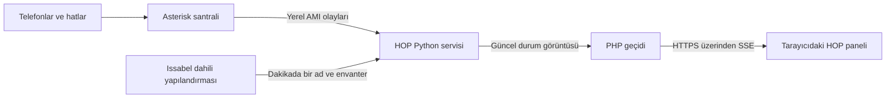

# HOP — HTML Operator Panel

**Santralinizi tek ekranda, canlı ve ücretsiz izleyin.**

HOP, Issabel ve Asterisk tabanlı telefon santralleri için geliştirilen,
Flash gerektirmeyen bir web operatör panelidir. Dahililerin durumunu, aktif
çağrıları, kuyrukları ve trunk kayıtlarını modern bir tarayıcıdan gösterir.
FOP/FOP2 kurulumu veya lisansı gerektirmez; bağımsız bir projedir.

**İndirme ve kullanım ücretsizdir. Abonelik, kullanıcı başına ücret veya
lisans anahtarı yoktur.** MIT lisansı altında kişisel ve ticari kullanım,
değiştirme ve yeniden dağıtım mümkündür. Sunucu ve telefon hizmeti giderleri
kullanıcıya aittir. [Lisans](LICENSE) · Geliştirici: **ckirnak** 🇹🇷

> Free, open-source HTML operator panel for Issabel/Asterisk. Monitor extensions,
> calls, queues and trunk registrations in real time using AMI and SSE.
> No Flash, subscriptions or license keys. MIT licensed.

## Neler yapar?

- SIP/PJSIP dahililerinde müsait, çalıyor, görüşmede ve çevrimdışı durumlarını gösterir.
- Arayan → hedef dahili ve adını, çağrı süresini ve kuyruk durumunu gösterir.
- Dahili numarası/adı araması ve durum filtreleri sunar.
- Trunk kayıt durumunu ve özet sayaçları gösterir.
- AMI olaylarıyla güncellenir; sayfayı üç saniyede bir yenilemez.
- Bağlantı kesildiğinde eski veriyi canlı gibi göstermek yerine bağlantı durumunu bildirir.

Mevcut sürüm **salt okunur izleme** içindir. Arama başlatma, aktarma, çağrı
sonlandırma ve ses kaydı özellikleri yoktur. Sihirbaz ilk kurulumun yanında
onaylı güncelleme ve önceki uygulama sürümüne geri dönmeyi destekler.

## Nasıl çalışır?



Python servisi santral üzerinde çalışır. AMI kullanıcı adı/parolası tarayıcıya
gönderilmez. Tarayıcı tek yönlü canlı veri akışı olan **Server-Sent Events (SSE)**
bağlantısını açık tutar. Yeni durum geldiğinde ilgili bilgiler güncellenir.
GitHub yalnızca kaynak kodunun dağıtım yeridir; santral verileri GitHub'a iletilmez.

[Ayrıntılı çalışma akışı ve diyagramlar](docs/ARCHITECTURE.md)

## İndir ve kur

1. Bu GitHub deposunda **Releases** bölümünden sürümün kaynak ZIP paketini
   veya **Code → Download ZIP** seçeneğini indirin.
2. ZIP'i açıp dosyaları kendi Issabel sunucunuza aktarın.
3. Sunucuda açılan HOP klasöründe önce `sudo bash install.sh --check`,
   ardından `sudo bash install.sh` çalıştırın.
4. Sihirbazın özetini okuyup `KUR` yazarak kurulumu başlatın.
5. Kendi santralinizin HTTPS adresindeki `/hop/` yolunu açın.

**Kurulum kapsamı:** systemd + Apache httpd + PHP-FPM kullanan Issabel/RHEL
ailesi düzeni. Python 3.6+ gerekir. Mevcut uygulama Asterisk 18 ortamında
kullanılmıştır; yeni sihirbaz tüm Issabel sürümlerinde doğrulanmış değildir.
Debian/Ubuntu, Docker, uzak AMI ve farklı PHP-FPM socket yolları bu sihirbazda
desteklenmez. Uygun olmayan sistemde ön kontrol durur.

**Erişim:** Panel giriş istemez. Adresi erişebilen kişiler çağrı numaralarını
ve dahili adlarını görebilir. Kurum ağı/VPN veya kendi erişim geçidinizle sınırlayın.
Kurucu firewall açmaz ve AMI'yi internete yayınlamaz.

[Adım adım sihirbaz rehberi, bakım ve geri alma](docs/INSTALL.md)

## Yeni sürümleri nasıl alırım?

GitHub deposunda **Watch → Custom → Releases** bildirimlerini açabilirsiniz.
Yeni Release'in ZIP paketini indirip santralde ayrı bir klasöre açın. O klasörde:

```sh
sudo bash install.sh --update --check
sudo bash install.sh --update
```

Sihirbaz sürümleri gösterir; `GUNCELLE` yazdığınızda yedek alıp günceller.
AMI hesabınız ve parolanız korunur. Hata halinde eski dosyalar geri alınır.
İndirme ve güncelleme yönetici tarafından başlatılır; arka planda otomatik yapılmaz.
[Ayrıntılar ve geri dönüş](docs/INSTALL.md#mevcut-kurulumu-güncellemek)

## Geliştirme ve yayın

Python tarafı standart kütüphane kullanır; pip bağımlılığı yoktur. Node.js
yalnızca HTML üretmek ve dağıtım hazırlamak için gerekir, santralde gerekmez.

```sh
node backend/build-live.cjs
cd backend
python3 -m unittest -v test_server test_setup test_update
```

[Değişiklik geçmişi](backend/CHANGELOG.md) · [GitHub yayın rehberi](docs/RELEASING.md)

[Bu sürümün test kapsamı ve sınırları](docs/VALIDATION.md)

MIT telif ve lisans bildiriminin korunmasını ister; arayüzdeki bayrağın veya
imzanın değiştirilmesini yasaklamaz. Bayrak varsayılan tasarımın parçasıdır;
kaldırılınca uygulamayı bozan bir kontrol yoktur.
