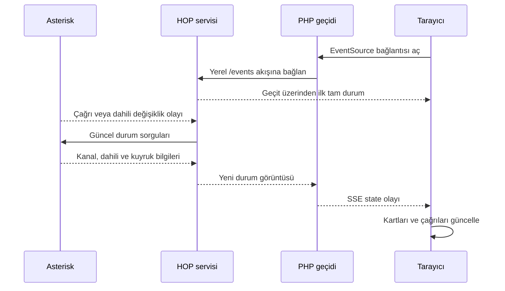
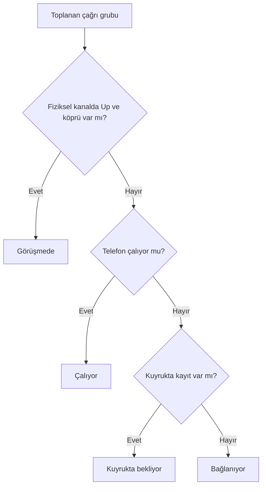

# Çalışma mantığı

## Veri toplama

HOP iki yerel AMI bağlantısı kullanır: biri olayları dinler, diğeri durum
sorgularını yürütür. İlgili olay geldiğinde yaklaşık 100 ms içindeki olaylar
birleştirilir ve yeni durum toplanır. Bu, her olayı tek tek kalıcı veritabanına
yazan bir sistem değil, olay tetiklemeli durum sorgulamasıdır.

ExtensionStateList, SIPpeers, PJSIPShowEndpoints, CoreShowChannels, QueueStatus
ve SIP/PJSIP kayıt sorguları kullanılır. İlk bağlantıda, yeniden bağlantıda ve
olaylara ek olarak 60 saniyelik uzlaştırmada güncel durum alınır.
Yoğun bir santralde sorgu yükü ve eşzamanlı panel sayısı ölçülmelidir.

## Çağrılar neden birden fazla kanaldan oluşur?

Bir dış hat, Local kuyruk bacakları ve dahili telefon aynı görüşmenin ayrı
kanalları olabilir. HOP bunları Linkedid ile birleştirir; yoksa Uniqueid
kullanır. Arayan ve hedef bilgisi geçici olarak eksilirse önceki aynı çağrı
kaydıyla birleştirir. Arayüz kanal sayısını çağrı sayısı diye sunmaz.

Özel dialplan, konferans, karmaşık transfer ve çok üyeli kuyruklarda hedef
çıkarımı her topolojiyi kapsamaz. SIP/PJSIP yapılandırmasındaki isimler dakikada
bir okunur; elle tanımlanan özel endpointler envanter desteği gerektirebilir.
Trunk listesi dahili olmayan peer/endpointlerden türetilir. **Kayıtsız**, mutlaka
arızalı demek değildir: IP doğrulamalı trunk register kullanmadan çalışabilir.

## SSE, bağlantı kaybı ve kaçırılan olaylar

SSE, HTTP bağlantısı üzerinden sunucudan tarayıcıya metin olayları gönderir.
Hareketsiz bağlantıda yaklaşık 10 saniyede bir heartbeat gönderilir. PHP akışı
yaklaşık 50 saniyede döndürür; tarayıcı yeniden bağlanır. Bu bir çağrı kesintisi değildir.

Bu sürüm geçmiş olayları Last-Event-ID üzerinden tekrar oynatmaz. Yeniden
bağlanınca tam güncel durum gönderilir; AMI yeniden bağlanınca da durum yeniden
toplanır. Böylece mevcut durum toparlanır. Kesinti sırasında başlayıp bitmiş
çağrıların tarihçesini sunmaz; geçmiş raporlar için santralin CDR kayıtları gerekir.

## Bileşenler ve sınırlar

| Bileşen | Görevi |
| --- | --- |
| `server.py` | AMI bağlantıları, durum birleştirme, localhost HTTP/SSE |
| `refresh_metadata.py` | Yapılandırmadan gerekli ad/numara ve trunk eşleştirme alanları |
| `gateway.php` | Yerel veriyi mevcut web sunucusu üzerinden aktarır |
| `live.js` | Canlı bağlantı, arama, filtreler ve görünüm |
| `hop-stream.conf` | HOP için FastCGI çıktı tamponlamasını kapatır |

SIP parolaları envantere alınmaz. AMI parolası `/etc/hop/ami.env` içinde root
erişimli tutulur. HOP işletim sistemi kullanıcısı ayrı ve oturum açamaz biçimdedir.
AMI localhost ACL kullanır; mevcut AMI bind ayarı ve diğer kullanıcılar değiştirilmez.
HTTP uçlarında AMI komut çalıştırma API'si yoktur. AMI sorguları için
`read=system,call,agent,reporting`, `write=system,reporting` kullanılır; bu nedenle
AMI kimlik bilgileri yalnızca sunucuda kalmalıdır.

Her açık SSE paneli bir PHP-FPM worker kullanır. Çok sayıda kullanıcı için
ayrı bir akış geçidi ve kapasite testi gerekir. HOP santral görüşmelerinin
yolunda değildir; panelin durması kendi başına telefon görüşmesini sonlandırmaz.
